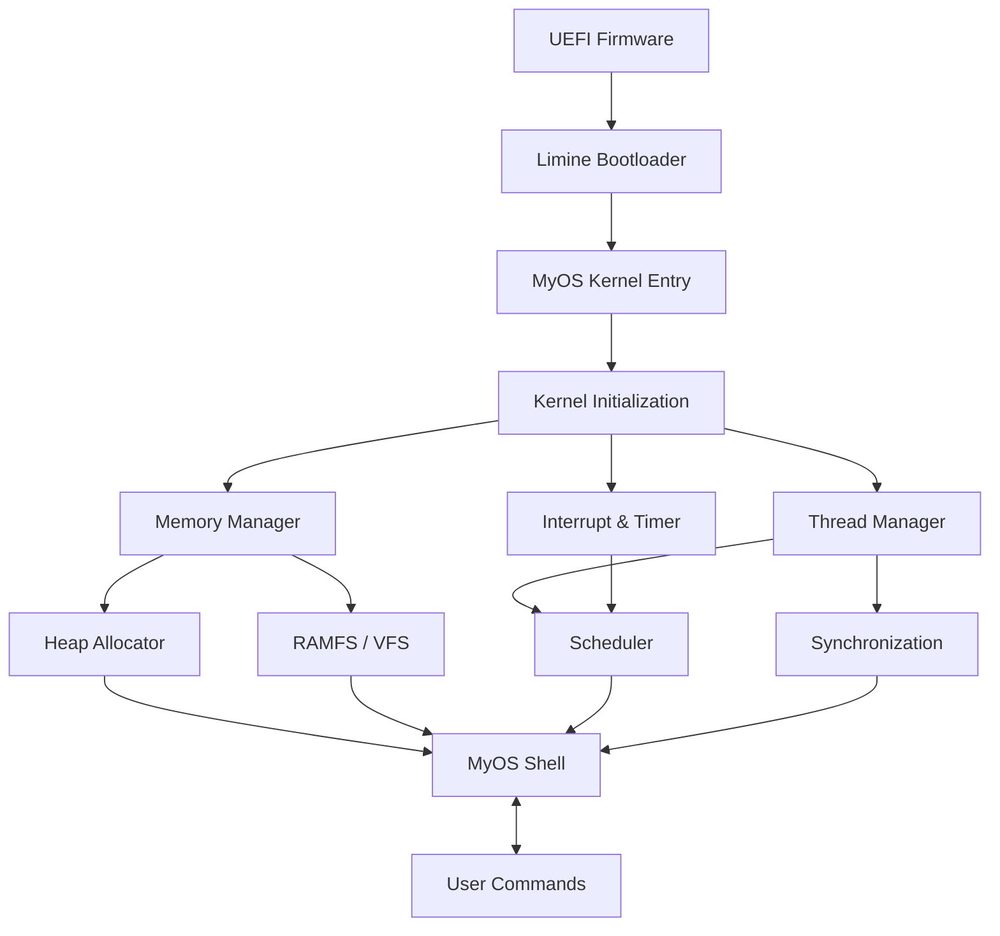
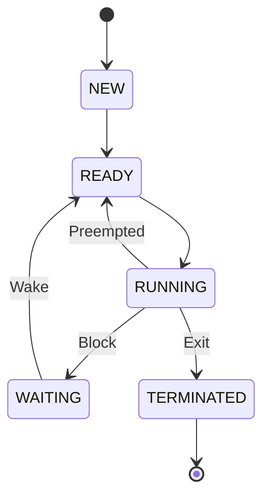
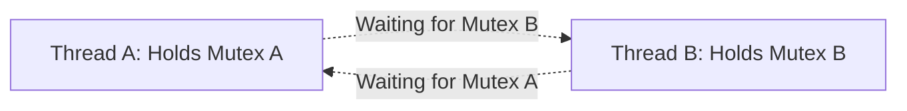

# MyOS — System Architecture

**Design Specification · V1.0 · Pre-implementation**

---

## 1. Visi arsitektur

MyOS adalah standalone kernel berbasis x86_64 yang boot melalui UEFI-compatible bootloader, menyediakan kernel subsystems dan interactive shell sebagai antarmuka utama.

### Core design philosophy
- **Observable**: mekanisme kernel dapat diamati melalui command shell.
- **Modular**: setiap subsystem punya tanggung jawab dan interface jelas.
- **Minimal**: hanya implementasi yang mendukung tujuan OS dan demonstrasi akademik.
- **Real**: scheduler, memory allocator, synchronization, dan filesystem benar-benar bekerja, bukan simulasi output.

MyOS bukan Linux yang dipoles, bukan aplikasi yang berjalan di atas Windows, dan bukan shell yang sekadar meniru operasi OS.

---

## 2. System architecture

MyOS menggunakan pendekatan modular monolithic kernel. Semua subsystem berjalan dalam kernel space, tetapi dipisahkan berdasarkan tanggung jawab.

V1 sengaja belum menggunakan user-space process terpisah. Proteksi menggunakan permission control internal agar scope tetap realistis.



### Layer dan tanggung jawab

| Subsystem | Tanggung jawab |
| :--- | :--- |
| **Boot** | Memuat kernel dan menyediakan boot information |
| **Core** | Entry point, init, panic, logging |
| **Interrupt** | IDT, interrupt handler, timer |
| **Scheduler** | Thread selection, context switch |
| **Thread** | TCB, thread lifecycle, stack |
| **Sync** | Mutex dan semaphore |
| **Memory** | Memory map, heap allocation |
| **VFS** | File interface dan RAM filesystem |
| **Security** | Permission dan access validation |
| **Shell** | Input, parsing, command execution |

---

## 3. Boot sequence

Target boot path: **UEFI → Limine → MyOS**

1. Firmware menjalankan UEFI dan mencari boot entry.
2. Bootloader Limine memuat kernel MyOS ke RAM.
3. Limine menyediakan boot information, termasuk memory map.
4. Kernel entry menjalankan initial setup.
5. Kernel menginisialisasi interrupt handling dan timer.
6. Kernel menyiapkan memory manager.
7. Kernel membuat thread awal dan scheduler.
8. Subsystem lain diinisialisasi.
9. Kernel menjalankan MyOS Shell.


### Boot output

Boot log bukan sekadar dekorasi. Setiap status harus mencerminkan hasil initialization yang sebenarnya.

```text
  __  __ __   __
 |  \/  |\ \ / /
 | |\/| | \ V /
 | |  | |  | |
 |_|  |_|  |_|

       MyOS
 Minimal Interactive Operating System

[BOOT] Bootloader detected
[INIT] CPU setup
[INIT] Interrupt subsystem
[INIT] Timer subsystem
[INIT] Memory manager
[INIT] Thread subsystem
[INIT] Scheduler
[INIT] Synchronization
[INIT] RAMFS

[SYSTEM] Initialization complete.

myos@kernel:~$
```

> **Catatan:** Log di atas merupakan target desain, bukan output kernel yang sudah diimplementasikan.

---

## 4. Kernel subsystem design

### 4.1 Interrupt subsystem

**Tujuan:** membuat kernel mampu merespons interrupt dan menjalankan scheduler secara preemptive.

**Komponen:**
- IDT (Interrupt Descriptor Table)
- Interrupt handlers
- Timer interrupt
- Interrupt control
- CPU register context

Timer berfungsi sebagai pemicu scheduler. Tanpa timer interrupt atau mekanisme preemption yang setara, thread yang menjalankan loop tanpa yield dapat memonopoli CPU.

**Design choice:** implementasi timer dan interrupt akan ditentukan sesuai target x86_64, dengan dokumentasi resmi Limine dan spesifikasi CPU sebagai referensi ketika masuk implementasi.

---

### 4.2 Thread management

Thread merupakan unit eksekusi yang dijadwalkan oleh kernel.
Setiap thread memiliki Thread Control Block (TCB).

```c
typedef enum {
    THREAD_NEW,
    THREAD_READY,
    THREAD_RUNNING,
    THREAD_WAITING,
    THREAD_TERMINATED
} thread_state_t;
```

Konseptual struktur thread:

```c
typedef struct thread {
    int id;
    char name[32];

    thread_state_t state;

    void *stack;
    void *stack_pointer;

    int priority;

    struct thread *next;
} thread_t;
```

Ini struktur konseptual. Field dan representasi context akan disesuaikan dengan implementasi context switching dan ABI x86_64.

#### Thread lifecycle



| State | Penjelasan |
| :--- | :--- |
| **New** | Thread baru dibuat |
| **Ready** | Siap dijalankan, menunggu CPU |
| **Running** | Thread sedang berjalan |
| **Waiting** | Thread menunggu resource atau event |
| **Terminated** | Thread sudah selesai |

---

### 4.3 Scheduler

**Policy:** Round Robin, preemptive

Round Robin dipilih karena lebih sederhana untuk diimplementasikan dan dibuktikan daripada scheduler kompleks.

**Konsep:**
- Thread berada di ready queue.
- Thread mendapatkan time slice.
- Timer interrupt memicu scheduler.
- Context thread disimpan.
- Scheduler memilih thread berikutnya.
- Context thread berikutnya dipulihkan.

#### Scheduling flow

```text
Ready Queue
Thread A · Thread B · Thread C
      ↓
Scheduler
Round Robin selection
      ↓
CPU Execution
One thread per time slice
      ↓
Timer Interrupt
Save context → Select next → Restore context
```

**Scheduler demonstration:**
- **Thread A:** increment counter.
- **Thread B:** print sequence.
- **Thread C:** loop calculation.

**Shell command:**
```text
sched test
```

**Expected demonstration:**
- Thread bergantian berjalan.
- Tidak bergantung pada cooperative yield saja.
- Scheduler dapat preempt thread yang masih running.
- Perubahan state ditampilkan.

---

### 4.4 Synchronization subsystem

**Target:** mutex dan shared-resource synchronization

MyOS akan menyediakan mutex untuk melindungi resource bersama.

#### Contoh shared counter
Dua thread mengakses counter yang sama.

```c
shared_counter++;
```

Tanpa mutex, operasi tersebut berpotensi mengalami race condition karena increment bukan operasi atomic secara keseluruhan.

**Race condition scenario**
Nilai awal: `100`
1. Thread A membaca nilai 100.
2. Thread B membaca nilai 100.
3. Thread A menulis 101.
4. Thread B menulis 101.

`Expected: 102 · Actual: 101`

**With mutex**
1. Thread A mengunci mutex.
2. Thread A mengubah counter.
3. Thread A membuka mutex.
4. Thread B mendapat lock dan mengubah counter.

`Expected: 102 · Actual: 102`

#### Mutex interface

```c
void mutex_init(mutex_t *mutex);
void mutex_lock(mutex_t *mutex);
void mutex_unlock(mutex_t *mutex);
```

Implementasi lock tidak boleh sekadar membuat loop polling yang mengunci CPU tanpa memperhatikan scheduler. Untuk V1, desain yang diinginkan adalah mutex yang mem-block thread ketika lock tidak tersedia, lalu mem-wake thread ketika lock dilepas.

#### Deadlock demonstration

Dua mutex:
- Mutex A
- Mutex B

Dua thread:
- **Thread A:** Lock A → Request B
- **Thread B:** Lock B → Request A



**Deadlock:** kedua thread tidak dapat melanjutkan eksekusi.

**Pencegahan:**
- Lock ordering.
- Tidak mengunci resource secara acak.
- Release resource dengan disiplin.
- Hindari circular wait.

Untuk demo, deadlock harus dijalankan dalam environment yang bisa di-reset. Jangan membuat deadlock permanent pada satu-satunya shell tanpa mekanisme recovery, karena itu akan mengubah demo menjadi sesi troubleshooting yang tidak direncanakan.

---

### 4.5 Memory management

**Target:** simple dynamic allocator

V1 menggunakan kernel heap sederhana berbasis free list.

**Fungsi utama:**
- Allocation.
- Release.
- Tracking heap usage.
- Tracking free memory.
- Safe handling ketika memory habis.

**Interface:**
```c
void *kmalloc(size_t size);
void kfree(void *ptr);
```

#### Konsep heap

```text
┌─────────────────┬─────────────────┬─────────────────┐
│ Allocated Block │   Free Block    │ Allocated Block │
│Memory digunakan │ Memory tersedia │Memory digunakan │
└─────────────────┴─────────────────┴─────────────────┘
```

**Shell commands:**
```text
mem status
mem test
```

`mem status` menampilkan:
- Heap capacity.
- Used memory.
- Free memory.
- Allocation count.

`mem test`:
1. Allocate memory.
2. Tampilkan usage.
3. Release memory.
4. Tampilkan usage.
5. Test allocation failure.

**Batas desain V1:** Kita belum membangun full virtual memory subsystem, demand paging, atau user-space isolation. Heap kernel yang benar-benar berfungsi sudah cukup untuk kebutuhan allocator rubric.

---

### 4.6 Virtual Filesystem

**Target:** VFS abstraction + RAMFS

RAMFS menyimpan file di RAM, bukan disk. Ini menghindari kompleksitas disk driver dan filesystem persistence yang tidak dibutuhkan untuk demonstrasi.

**Interface konseptual:**
```c
int fs_create(const char *name);
int fs_write(const char *name, const char *data);
int fs_read(const char *name, char *buffer);
int fs_delete(const char *name);
```

**Struktur file:**
```c
typedef struct ramfs_file {
    char name[64];
    char *data;
    size_t size;

    struct ramfs_file *next;
} ramfs_file_t;
```

**Shell commands:**
```text
fs ls
fs write note.txt "Hello MyOS"
fs read note.txt
fs rm note.txt
```

**File operation lifecycle:**
```text
Create (Allocate metadata) → Write (Store content) → Read (Retrieve content) → Delete (Free resources)
```

---

### 4.7 Security & access control

Untuk V1, MyOS menggunakan permission-based access control, bukan full user/kernel privilege separation.

**Kenapa?**
User/kernel mode separation pada x86_64 berarti kita harus mengelola privilege transitions, user-mode execution, page permissions, syscall entry/exit, dan isolasi address space secara lebih serius. Itu bagus sebagai pengembangan berikutnya, tetapi bukan syarat minimum assignment.

Kita tetap membuat sistem akses yang nyata.

**Contoh permission:**

| Permission | Hak akses |
| :--- | :--- |
| **Read** | Membaca file/resource |
| **Write** | Menulis file/resource |
| **Execute** | Menjalankan operasi tertentu |
| **Admin** | Mengubah resource privileged |

**Konsep:**
```c
typedef enum {
    PERM_READ,
    PERM_WRITE,
    PERM_EXEC,
    PERM_ADMIN
} permission_t;
```

**Demonstration:**
```text
myos@kernel:~$ security test

[TEST] Read permitted resource
[PASS] Access granted

[TEST] Write protected resource
[PASS] Access denied

[TEST] Privileged operation
[PASS] Access denied for non-admin
```

Ini harus menggunakan permission checking yang benar-benar memblokir operasi, bukan sekadar mencetak pesan denial.

---

## 5. MyOS Shell

Shell merupakan interface interaktif utama untuk mengakses subsystem kernel.
Shell tidak berfungsi sebagai kernel. Shell adalah interface yang memanggil fungsi subsystem kernel.

### Command architecture


### Command registry

| Command | Fungsi |
| :--- | :--- |
| `help` | Menampilkan daftar command |
| `sysinfo` | Informasi sistem |
| `clear` | Membersihkan console |
| `thread list` | Menampilkan thread |
| `thread demo` | Thread demonstration |
| `sched test` | Menguji preemptive scheduling |
| `sync test` | Menguji synchronization |
| `deadlock test` | Menguji deadlock |
| `mem status` | Menampilkan memory usage |
| `mem test` | Menguji allocator |
| `fs ls` | Daftar file |
| `fs write` | Membuat atau menulis file |
| `fs read` | Membaca file |
| `fs rm` | Menghapus file |
| `security test` | Menguji access control |

Shell parser sebaiknya dibuat sederhana untuk V1. Tokenisasi command, parameter, dan string argument sudah cukup. Kita tidak perlu membuat scripting language.

---

## 6. Struktur project final untuk V1

Struktur awal yang lebih konkret daripada struktur README:

```text
MyOS/
├── boot/
│   └── limine/
├── kernel/
│   ├── entry/
│   │   ├── entry.S
│   │   └── main.c
│   ├── core/
│   │   ├── panic.c
│   │   └── log.c
│   ├── arch/
│   │   └── x86_64/
│   │       ├── gdt.c
│   │       ├── idt.c
│   │       ├── interrupt.S
│   │       ├── timer.c
│   │       └── context.S
│   ├── scheduler/
│   │   ├── scheduler.c
│   │   └── thread.c
│   ├── sync/
│   │   ├── mutex.c
│   │   └── semaphore.c
│   ├── memory/
│   │   ├── memory.c
│   │   └── heap.c
│   ├── fs/
│   │   ├── vfs.c
│   │   └── ramfs.c
│   ├── security/
│   │   └── permissions.c
│   ├── drivers/
│   │   ├── serial.c
│   │   └── keyboard.c
│   └── shell/
│       ├── shell.c
│       ├── parser.c
│       └── commands.c
├── include/
│   ├── kernel/
│   ├── arch/
│   ├── scheduler/
│   ├── sync/
│   ├── memory/
│   ├── fs/
│   ├── security/
│   └── shell/
├── docs/
│   ├── ARCHITECTURE.md
│   ├── DESIGN_DECISIONS.md
│   ├── TEST_PLAN.md
│   └── AI_USAGE.md
├── tests/
│   └── host/
├── Makefile
├── limine.conf
└── README.md
```

Struktur ini bukan berarti semua file harus dibuat sejak hari pertama. File baru dibuat saat subsystem terkait mulai dikerjakan.

---

## 7. Design decisions

Beberapa keputusan sengaja kita tetapkan agar tidak berubah-ubah di tengah implementasi.

| Keputusan | Pilihan V1 | Alasan |
| :--- | :--- | :--- |
| **CPU architecture** | x86_64 | Relevan dengan QEMU dan PC |
| **Bootloader** | Limine | Mengurangi pekerjaan boot protocol |
| **Boot target** | UEFI | Target modern |
| **Kernel** | Monolithic | Lebih sederhana untuk scope akademik |
| **Language** | C + Assembly | Praktis dan relevan untuk low-level |
| **Scheduler** | Round Robin | Mudah didemonstrasikan |
| **Thread** | Kernel thread | Scope realistis |
| **Synchronization** | Mutex + semaphore | Memenuhi requirement |
| **Memory allocator** | Free list | Sederhana untuk demonstrasi |
| **Filesystem** | RAMFS | CRUD tanpa disk driver |
| **Security** | Permission checking | Sesuai minimum rubric |
| **Debugging** | Serial console | Output yang stabil |
| **Emulator** | QEMU | Development dan test |
| **AI agent** | Hermes | Development assistance |

### Mengapa bukan Rust?
Rust sangat menarik untuk kernel development karena memory safety. Tetapi C + Assembly dipilih untuk V1 bukan karena Rust buruk, melainkan karena kita ingin menekan kompleksitas tooling, memahami struktur kernel secara eksplisit, dan lebih mudah menghubungkan implementasi dengan materi OS yang diajarkan.

Kalau tim sudah kuat di Rust, keputusan ini bisa diperdebatkan. Namun, mengganti bahasa hanya karena terlihat lebih modern bukan alasan teknis yang cukup.

---

## 8. Development roadmap

- **Phase 1 · Boot foundation:** Limine, kernel entry, serial output, shell, commands
- **Phase 2 · Threads:** TCB, stack, thread creation, lifecycle
- **Phase 3 · Scheduler:** Timer interrupt, context switching, Round Robin
- **Phase 4 · Synchronization:** Mutex, shared counter, race condition, deadlock
- **Phase 5 · Memory & Filesystem:** Heap allocator, RAMFS CRUD
- **Phase 6 · Security & testing:** Permissions, denial tests, integrated tests
- **Phase 7 · Bootable media:** ISO, UEFI boot, USB validation, hardware testing

> Jangan melompat ke Phase 7 sebelum Phase 3 stabil.
> Scheduler dan context switching merupakan salah satu titik risiko tertinggi. Kalau mekanisme tersebut belum benar, demo thread, mutex, dan deadlock akan ikut rusak. Membangun semuanya sekaligus hanya membuat debugging lebih mahal.

---

## 9. Definition of Done

Sebuah subsystem tidak dianggap selesai hanya karena compile berhasil.

| Subsystem | Bukti selesai |
| :--- | :--- |
| **Boot** | Kernel boot melalui bootloader dan mencapai shell |
| **Shell** | Command input dan output bekerja |
| **Thread** | Thread dibuat dan lifecycle ditampilkan |
| **Scheduler** | Preemption terverifikasi |
| **Sync** | Shared counter konsisten dengan mutex |
| **Deadlock** | Deadlock dapat didemonstrasikan dan dijelaskan |
| **Memory** | Allocation, release, OOM test |
| **RAMFS** | CRUD berfungsi |
| **Security** | Unauthorized operation benar-benar ditolak |
| **ISO** | Kernel dapat boot dari ISO di QEMU |

---

## 10. Peran Hermes AI Agent

Hermes bukan bagian dari kernel. Hermes adalah development agent yang membantu tim membangun dan menguji kernel.

| Tugas Hermes | Batasan |
| :--- | :--- |
| Generate kode | Kode harus direview |
| Analisis bug | Diagnosis harus diverifikasi |
| Membantu GDB | Debugging tetap dipahami tim |
| Membuat test | Test harus dijalankan |
| Membaca dokumentasi | Verifikasi sumber |
| Membuat dokumentasi | Harus sesuai implementasi |
| Membantu refactoring | Tidak mengubah architecture sembarangan |

### Aturan untuk agent
- Tidak mengubah arsitektur tanpa persetujuan.
- Tidak menganggap compile sebagai keberhasilan.
- Tidak menghapus test yang gagal untuk membuat build hijau.
- Setiap perubahan harus menyertakan alasan.
- Setiap subsystem harus bisa dijelaskan oleh anggota tim.

Kita juga perlu dokumentasi AI usage agar penggunaan GenAI transparan sesuai assignment.

---

## 11. Keputusan yang belum boleh kita ambil

Ada beberapa hal yang sengaja ditunda:
- GPU dan GUI.
- Networking.
- USB device driver kompleks.
- Full user-space.
- Disk persistence.
- Multicore SMP.
- Full virtual memory management.
- AI inference langsung di kernel.
- Dual boot installation di perangkat utama.

Scope creep adalah ancaman terbesar terhadap proyek ini. OS yang berhasil boot, scheduler-nya benar, mutex-nya benar, RAMFS-nya bekerja, dan bisa dibuktikan jauh lebih kuat untuk assignment daripada OS dengan GUI setengah jadi tetapi core-nya tidak bisa dijelaskan.

---

## 12. Langkah berikutnya

Architecture ini sudah cukup sebagai baseline untuk mulai implementasi, dengan beberapa detail low-level yang masih perlu divalidasi terhadap bootloader dan ABI x86_64.

Urutan kerja yang saya rekomendasikan:
1. Finalisasi `ARCHITECTURE.md`.
2. Buat `DESIGN_DECISIONS.md` untuk alasan teknis dan trade-off.
3. Buat `TEST_PLAN.md` yang menghubungkan requirement assignment dengan test.
4. Setup development environment.
5. Implement Phase 1, kernel boot dan shell.
6. Baru lanjut ke thread dan scheduler.

> **Prioritas pertama:** kernel yang benar-benar boot dan menerima command, bukan kernel yang terlihat keren di README.